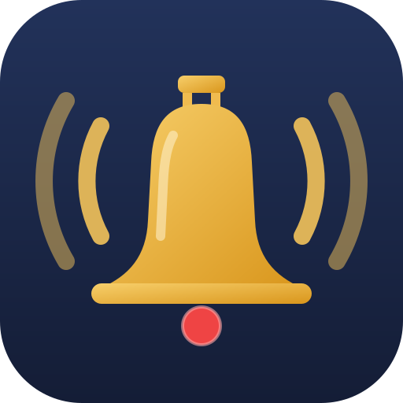
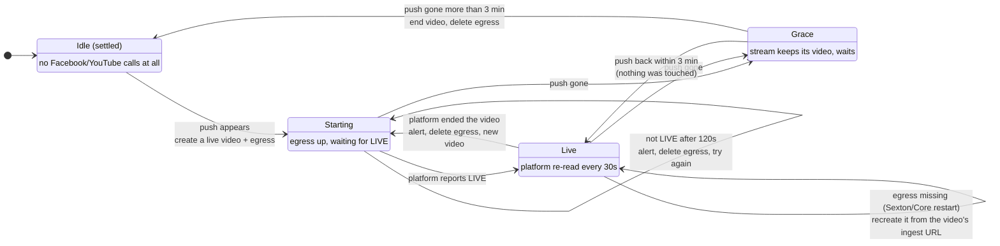
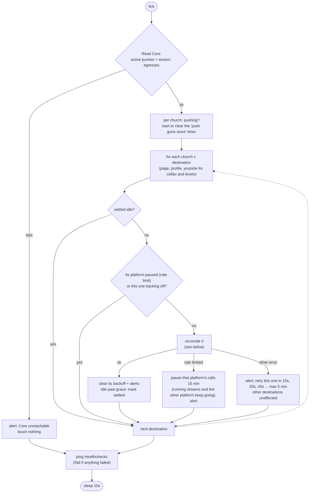
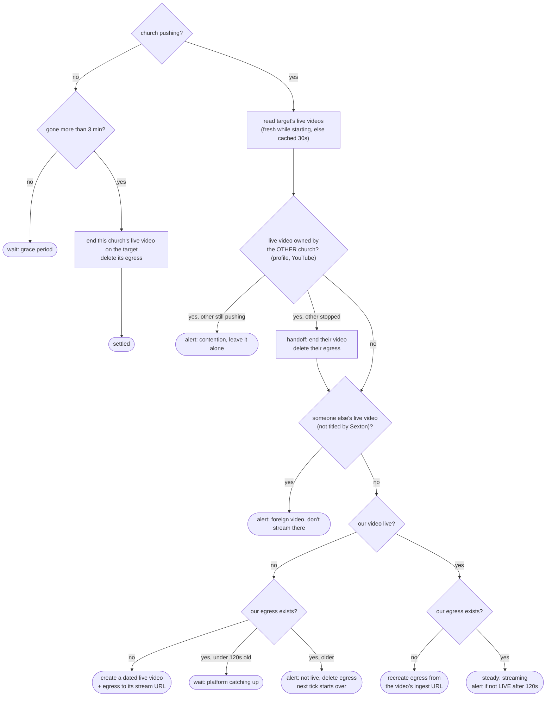

# Sexton

The sexton rings the bells. This one goes live on Facebook (the church's Page and
the personal profile) and YouTube whenever OBS/Mevo starts pushing to a church's
Restreamer channel, and ends the broadcasts once the push has been gone for 3
minutes. Every service becomes its own video, titled with the lectionary day,
e.g. "Colfax UMC Worship – Proper 7, Year A – Jun 21, 2026", with that Sunday's
readings in the description.

Sexton replaces the Restreamer UI's Facebook and YouTube egresses: delete those
from the UI (keep the channels themselves), or both will stream at once.

## How it works

Every ~10 seconds, for each input (church) and each of its destinations (its Page,
the shared personal profile, the shared YouTube channel), Sexton reads:

- **pushing**: is the channel in Core's `GET /api/v3/rtmp`?
- **live**: does the target have an active live video titled for this input?
- **egress**: does Core have the process `sexton:<input>:<destination>`?

and converges:

| State | Action |
|---|---|
| pushing, not live, no egress | create a `LIVE_NOW` video, then an egress to its `secure_stream_url` |
| pushing, live, no egress | recreate the egress from the video's ingest URL (restart mid-service) |
| pushing, egress < 120s old, not live yet | wait (no duplicate video) |
| pushing, egress ≥ 120s old, not live | alert, delete egress so the next tick starts over |
| pushing, a shared target (profile, YouTube) is live for the *other* church, which has stopped | end that video, then start this one |
| pushing, a shared target is live for the other church, which is *still pushing* | alert "contention", leave it alone |
| not pushing for > 180s | end this input's videos, delete its egresses |

No files, no database. Facebook and Core are the source of truth. The only things
held in memory are the "stopped pushing at" timer (a restart resets it, which can
only *delay* an end), a short Facebook read cache, and alert deduplication.

Egress processes are plain stream copy (`-c copy -f flv`) from the channel's
internal RTMP stream, the same source the Restreamer UI's own RTMP egresses use.
Sexton never creates, changes or deletes a process whose id doesn't start with `sexton:`.

### A service, start to finish

One church's broadcast to one destination (its Page, the profile, or YouTube).
Each destination follows this independently; nothing here is stored except the
"push gone since" timer.



### Every tick (10s)



### Reconciling one destination



## Alerts

Via ntfy, deduplicated (once per problem, at most hourly re-sends, plus a
"Recovered" note): Core unreachable, any create/end/egress failure, Facebook or
YouTube auth/permission errors, rate limits (that platform pauses 15 min), not LIVE
within 2 minutes, an unknown live video occupying a target, contention on a shared
target, and unexpected exceptions. Healthchecks.io gets pinged
every loop (`/fail` when a tick had errors), so a stopped Sexton is noticed too.

## Configuration

`config.yaml` (see `config.example.yaml`) maps inputs to destinations. Secrets
come only from env vars:

| Variable | Purpose |
|---|---|
| `CORE_USERNAME`, `CORE_PASSWORD` | Restreamer Core API login (names set in config) |
| `FB_TOKEN_*` | Page tokens / user token with `publish_video` (names set in config) |
| `YT_CLIENT_ID`, `YT_CLIENT_SECRET` | Google OAuth client (only with a YouTube destination) |
| `YT_REFRESH_TOKEN` | YouTube channel refresh token (see below; name set in config) |
| `NTFY_URL` | Full topic URL, e.g. `https://ntfy.sh/your-topic` |
| `NTFY_TOKEN` | Optional ntfy access token |
| `HEALTHCHECK_URL` | Healthchecks.io ping URL |

The Graph API version is the single constant `GRAPH_API_VERSION` in `sexton/facebook.py`.

## Running

```sh
docker build -t sexton .
docker run --rm --env-file sexton.env -v $PWD:/config:ro sexton --dry-run --once
```

`--dry-run` performs all reads but logs (and skips) every create/end/delete,
ntfy alert and healthcheck ping. `--once` runs a single tick. Logs are JSON lines
on stdout. For Unraid, use `unraid-template.xml` (copy it to
`/boot/config/plugins/dockerMan/templates-user/my-sexton.xml`, then Add Container →
Template: sexton) or `docker-compose.example.yml`.

Tests: `pip install -r requirements-dev.txt && pytest`

## Titles and readings

Titles come from `title_format` in `config.yaml`. `{day}` is the Revised Common
Lectionary day: holy days by name (Christmas Eve, Ash Wednesday, Good Friday...),
otherwise the nearest Sunday ("Third Sunday in Lent", "Proper 7", "Christ the King
(Proper 29)"). `{year}` is "Year A/B/C", which turns over on the First Sunday of
Advent.

Readings go in `readings/year-a.json`, `year-b.json` and `year-c.json` next to
`config.yaml`, keyed by those day names, with whatever labels you like:

```json
"Proper 7": { "Old Testament": "Jeremiah 20:7-13", "Gospel": "Matthew 10:24-39" }
```

Filled-in entries are added to the stream description under "Readings"; blank or
missing ones are skipped. Files are re-read for each new video, so edits apply
without a restart. To create the files with every day name ready to fill in, or
to add new day names to them later (never overwrites):

```sh
docker run --rm --user root --entrypoint python \
  -v /mnt/user/appdata/automation/sexton:/config jpschafer/sexton:latest \
  -m sexton.readings init /config/readings
docker exec sexton python -m sexton.readings show /config/readings 2026-06-21
```

## YouTube setup (one time)

Sexton creates a broadcast per service (auto-start on, auto-stop off, so short
drops don't split the video), bound to a reusable stream key titled `sexton` that
it creates on the channel the first time. It never touches the channel's
persistent "Stream now" broadcast. Each call costs 1 unit of the 10,000/day quota;
a 2-hour service uses roughly 500.

1. [Google Cloud console](https://console.cloud.google.com/): create a project and
   enable **YouTube Data API v3**.
2. **OAuth consent screen**: user type *Internal* if you have Google Workspace
   (only your org can sign in), otherwise *External*; add the scope
   `.../auth/youtube`; then **Publish app** so it's *In production*. A *Testing*
   app's refresh tokens die after 7 days. Google verification is not needed for
   your own use: you'll click past an "unverified app" warning once.
3. **Credentials → Create OAuth client ID → Desktop app**. Put the ID and secret in
   `YT_CLIENT_ID` / `YT_CLIENT_SECRET` and restart the container.
4. Get the refresh token:
   ```sh
   docker exec -it sexton python -m sexton.youtube_auth
   ```
   Open the link, sign in as the channel's manager (pick the channel if it's a
   Brand Account), approve, then paste the address of the page that fails to load
   (`http://127.0.0.1:8765/?...`). It prints the channel name and
   `YT_REFRESH_TOKEN`; set that and restart. It doesn't expire on a production
   app; if it's ever revoked, Sexton alerts and you repeat this step.
5. Delete the Restreamer UI's YouTube egresses.

## Renewing the Facebook user token

The user token (profile streaming) lasts about 60 days, and Facebook requires a
login for every new one. Page tokens don't expire.

### On a Mac (recommended)

`macos/` holds a launchd agent that checks the token every day at 9:00 (and at
login). When Facebook reports it expires within 10 days, or it's invalid, you get a
notification, and Terminal opens `renew.command`, which opens Graph API Explorer,
exchanges the token you paste, saves it to the Keychain, and copies it to the
clipboard for pasting into the Unraid template.

```sh
sexton/macos/install.sh              # install; runs a first check right away
sexton/macos/renew.command           # renew by hand at any time
sexton/macos/install.sh --uninstall  # remove
```

The app ID, app secret and current token live in the login Keychain under the
service `sexton-facebook`. Log: `~/Library/Logs/sexton-fb-token.log`.

### From the container

To renew from Unraid instead:

```sh
docker exec -it sexton python -m sexton.renew_token
```

It prints the Graph API Explorer steps, asks for your app ID, app secret and the
short-lived token (hidden input; or set `FB_APP_ID` / `FB_APP_SECRET`), and prints
the new long-lived token, its expiry date, and fresh Page tokens. Paste them into
the container's variables and restart. It changes nothing on its own.

## To verify before the first real Sunday

These weren't confirmable from documentation. Each is isolated in one place in
the code:

1. **`broadcast_status` filter on `GET /{target}/live_videos`**: missing from
   the current reference docs. Sexton sends it *and* filters on `status`
   client-side, so a server that ignores it is harmless. Check in Graph Explorer
   that the call returns your live video at all (`facebook.py: active_live_videos`).
2. **Status of a `LIVE_NOW` video before frames arrive.** If it isn't `LIVE`,
   Sexton still won't duplicate it (the young egress counts as "pending"), but
   you may want to add that status to `ACTIVE_STATUSES` once observed.
3. **Graph API version**: the changelog lists v26.0 as the newest release, but
   the docs' examples already use v27.0. Bump the constant when v27.0 is listed.
4. **Channel name format from `/api/v3/rtmp`** on your instance: Sexton compares
   the last path segment (`/live/<id>.stream` → `<id>.stream`) with `rtmp_name`.
   Check with `curl` during a test push.
5. **How long Facebook waits before auto-ending a silent broadcast.** If it's
   under 3 minutes, a long drop ends the video on Facebook's side; Sexton alerts
   and starts a new video when the push returns.

Suggested dry run: start a test push on a weekday, run with `--dry-run` and
read the `create_live_video` / `create_egress` log lines. Then do a real run
with `privacy: {"value": "SELF"}` on the profile.
